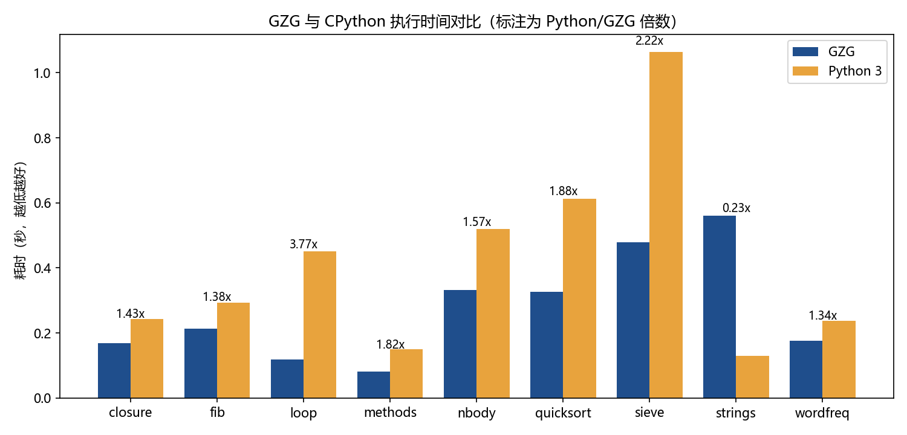

# GZG 性能测试报告

## 1. 测试目的与方法

比较 GZG 解释器与 CPython 在相同计算任务上的执行速度，找出 GZG 的优势和短板，并解释原因。

- **用例**：`bench/cases/` 下 9 对同名脚本（`x.gzg` 与 `x.py`），算法、数据规模、输出格式完全相同。随机数据用相同的线性同余公式生成，不依赖各自语言的随机数库。
- **正确性前提**：驱动脚本先各运行一次，校验两者 stdout **逐字相同**，再计时。
- **计时**：每个用例运行 N 次（默认 5 次），取进程墙钟时间的中位数，包含进程启动时间（本机实测空程序：GZG 约 24ms，CPython 约 47ms，主要是 Windows 创建进程的开销）。
- **运行**：`python bench/run_bench.py`（或 `make bench`），结果写入 `bench/results/`（`report.md`、`results.json`、`chart.png`）。
- **GC 统计**：`gzg --stats 文件` 在运行结束后打印 GC 次数、GC 耗时、累计分配量、堆峰值。

| 用例 | 考察的语言特性 | 规模 |
|---|---|---|
| fib | 递归函数调用 | fib(32)，约 700 万次调用 |
| loop | 整数算术、嵌套数值循环、位运算 | 300 万次迭代 |
| sieve | 数组下标读写、while 循环 | 500 万的埃氏筛 |
| quicksort | 递归 + 数组随机访问 + 交换 | 30 万个整数 |
| strings | 字符串插值、join、split、ends_with、`+=` 拼接 | 20 万个片段 |
| wordfreq | 字典插入、查找、更新，带键函数排序 | 40 万次更新 |
| nbody | 结构体字段读写、浮点运算、`sqrt` | 5 个天体 10 万步 |
| closure | 闭包、`map`/`filter`/`reduce` 回调 | 150 万次回调 |
| methods | 结构体方法调用 | 100 万次调用 |

## 2. 结果

<!-- 下表由 bench/run_bench.py 的输出整理 -->
环境：Windows 11 / AMD64 Family 25 Model 117 Stepping 2, AuthenticAMD；GZG 1.0.0（gcc 8.1 -O2）对 Python 3.12.4；每项 5 次取中位数；2026-10-28 20:49。倍数大于 1 表示 GZG 更快。

| 用例 | 测试内容 | GZG (s) | Python (s) | Python/GZG | 输出一致 |
|---|---|---:|---:|---:|:---:|
| closure | 闭包与 map/filter/reduce | 0.169 | 0.242 | **1.43x** | ✓ |
| fib | 递归函数调用 fib(32) | 0.213 | 0.293 | **1.38x** | ✓ |
| loop | 300 万次整数运算的嵌套循环 | 0.120 | 0.451 | **3.77x** | ✓ |
| methods | 100 万次方法调用 | 0.082 | 0.150 | **1.82x** | ✓ |
| nbody | N 体模拟 10 万步（结构体字段 + 浮点） | 0.331 | 0.519 | **1.57x** | ✓ |
| quicksort | 手写快速排序 30 万个数（递归 + 数组） | 0.326 | 0.612 | **1.88x** | ✓ |
| sieve | 埃氏筛 500 万（数组下标读写） | 0.479 | 1.065 | **2.22x** | ✓ |
| strings | 字符串插值、join/split、拼接 | 0.561 | 0.129 | **0.23x** | ✓ |
| wordfreq | 字典词频统计 40 万次 + 排序 | 0.177 | 0.237 | **1.34x** | ✓ |
| **几何平均** | | | | **1.44x** | |



### GC 统计（`gzg --stats`）

| 用例 | 总耗时 (s) | GC 次数 | GC 耗时 (s) | GC 占比 | 累计分配 (MB) | 堆峰值 (MB) |
|---|---:|---:|---:|---:|---:|---:|
| fib | 0.182 | 0 | 0.000 | 0.0% | 0.0 | 0.0 |
| loop | 0.083 | 0 | 0.000 | 0.0% | 0.0 | 0.0 |
| sieve | 0.436 | 3 | 0.002 | 0.6% | 128.0 | 128.0 |
| quicksort | 0.303 | 1 | 0.000 | 0.0% | 8.0 | 8.0 |
| strings | 0.574 | 15 | 0.207 | 36.1% | 424.2 | 60.4 |
| wordfreq | 0.143 | 1 | 0.007 | 4.7% | 15.5 | 8.0 |
| nbody | 0.304 | 0 | 0.000 | 0.0% | 0.0 | 0.0 |
| closure | 0.134 | 4 | 0.002 | 1.5% | 58.0 | 36.0 |
| methods | 0.056 | 0 | 0.000 | 0.0% | 0.0 | 0.0 |

## 3. 分析

### 3.1 GZG 更快的原因

**数值是值类型。** GZG 的整数和浮点数直接存放在 16 字节的 `Value` 里，`a + b` 只是两次读、一次加、一次写。CPython 中每个 int/float 都是堆对象，运算要创建新对象并维护引用计数。这一点在 `loop`（纯整数运算）上体现得最明显，GZG 快 3 倍以上；`fib`、`nbody` 中的算术也受益于此。上表中 fib、loop、nbody、methods 四个用例 **累计分配为 0**，整个运行过程没有任何堆分配。

**变量在编译期解析。** 局部变量编译为栈槽下标（`GET_LOCAL 1`），全局变量编译为全局数组下标（`GET_GLOBAL 61`），运行时不做任何按名字的查找。CPython 的局部变量同样是数组访问，但全局变量和内建函数（如 `len`）需要查字典。

**专用循环指令。** `for i in a..b` 编译为 `FOR_PREP / FOR_RANGE / FOR_STEP` 三条指令，循环变量的比较和自增在一条指令内完成，不创建迭代器对象；CPython 的 `for i in range(n)` 每一轮都要调用迭代器的 `__next__` 并创建新的 int 对象。

**指令分派与调用。** 虚拟机用 GCC 的 computed goto，每条指令末尾直接跳转到下一条的处理代码。函数调用时实参已在栈上，新调用帧直接把它们当作局部变量，不复制、不创建帧对象；参数个数恰好匹配的闭包调用走内联快速路径。

**方法调用不创建绑定对象。** `obj.m(x)` 编译为一条 `INVOKE` 指令，直接查结构体的方法表并调用。`methods` 用例因此比 CPython 快约一倍。

### 3.2 strings 用例更慢的原因

`strings` 是唯一 GZG 更慢的用例。用 `--stats` 定位：GC 占了约 36% 的时间，累计分配 424MB，而其他用例都在 130MB 以下。逐段计时（`clock()`）显示，开销集中在最后一段：

```gzg
let s = ""
for i in 0..20000 { s += "ab" }     # 2 万次拼接，最终 4 万字符
```

**根因：**

1. **CPython 对 `s += x` 有原地扩容优化。** 当字符串的引用计数为 1 时，CPython 直接 `realloc` 原字符串并追加，拼接是均摊 O(1)。GZG 的字符串不可变且全部驻留，每次 `+=` 都要分配新字符串、复制旧内容、计算哈希、查驻留表，整体是 O(n²)：2 万次拼接共复制约 400MB。
   作为对照，让 CPython 无法使用这个优化（循环里额外保留一个引用），同一段代码在 CPython 上从 0.008s 变为 0.15s，与 GZG 的 0.16s 相当。
2. **追踪式 GC 要扫描所有存活对象。** 这个用例同时持有 20 万个存活的小字符串（`parts` 和 `fields` 数组）。拼接产生的大量垃圾触发了 15 次 GC，每次都要标记并清扫这 20 万个对象，约 15ms/次。CPython 的引用计数会在旧字符串失去引用时立即释放，不需要扫描存活对象。

**已做的优化：**

| 优化 | 效果 |
|---|---|
| 拼接时直接在新对象里构造，只复制一次（原先先拼到临时缓冲再复制进对象） | 拼接段 0.63s → 0.16s |
| 字符串哈希从逐字节 FNV-1a 改为每次处理 8 字节的乘法-异或哈希 | 同上（两项合计） |
| 字符串、区间、原生函数作为叶子对象，标记后不进入灰栈 | GC 耗时 −10% |
| GC 最小阈值从 1MB 提高到 8MB | 小堆程序的 GC 次数大幅减少（wordfreq 18 次 → 1 次） |

`strings` 用例总耗时从 1.12s 降到约 0.56s。

**进一步的方向与取舍：** 彻底解决需要 CPython 式的“唯一引用时原地追加”，而追踪式 GC 不知道一个对象有几个引用；或者引入专门的字符串构建器类型、分代 GC。考虑到 GZG 已经提供了 `parts.push(x)` + `parts.join("")` 这一线性时间的写法（用例中 20 万片段的 join 只需 8ms），我们在开发指南中推荐这种写法，没有为此增加实现复杂度。

### 3.3 其他观察

- **sieve** 分配了 128MB：`[true] * 5000001` 创建了 500 万个 16 字节的 `Value`。CPython 的列表只存 8 字节指针（`True` 是单例），内存更省，但 GZG 访问时少一次间接寻址，速度仍快约 2 倍。
- **wordfreq** 中字符串拼接 `words[i] + str(n)` 的结果大多已在驻留表中，查到后直接复用，不产生新对象，所以 GC 压力很小。
- **closure** 中 `map`/`filter`/`reduce` 的每次回调都要从原生代码重新进入虚拟机，约 150 万次回调仍比 CPython 快约 40%。

## 4. 结论

在 9 个用例中，GZG 有 8 个快于 CPython 3.12，几何平均为 CPython 的 1.44 倍速度。优势来自值类型数字、编译期变量解析、专用循环指令与轻量的调用约定；短板是大量 `+=` 拼接字符串时的 O(n²) 复制和追踪式 GC 对大量存活对象的扫描开销，根因已定位，并给出了推荐写法。

## 5. 复现

```bash
make                         # 编译（gcc -O2）
python bench/run_bench.py    # 或 --runs 10 / --only fib,loop
build/gzg --stats bench/cases/strings.gzg
```
